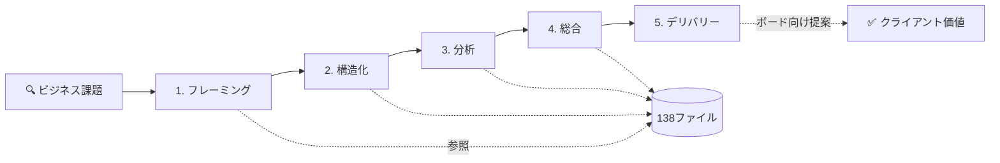

# MBB経営コンサルタント AI スキル・プラグイン（LLM対応版）

> **最も包括的なオープンソース・コンサルティング知識層。** Claude、Codex、Gemini、GitHub Copilot、Cursor、Ollama、その他あらゆるAIアシスタント向けの構造化・仮説主導型のコンサルティング知識ベース。MBA学生、ケース面接対策者、ビジネス専門家向け。McKinsey/Bain/BCGレベルの思考能力を提供します。

[](https://opensource.org/licenses/Apache-2.0)
[](#インストール)
[](#インストール)
[]()
[]()

---

## これは何か？

**MBB経営コンサルタント AI スキル**は、AI アシスタント（Claude、Codex、Gemini、GitHub Copilot、Ollama など）にシニア・ストラテジー・コンサルタントの認知アーキテクチャを与えるための構造化知識システムです。単純なプロンプトではなく、**138のリファレンス・モジュール**から構成されており、MECE問題分解、ピラミッド・プリンシプル・コミュニケーション、M&A デューディリジェンス、GenAI エンタープライズ戦略、ケース面接コーチングまで、コンサルティング業務のあらゆる領域をカバーしています。

### 特徴

このスキルは一般的なAIプロンプトとは異なります：

- **仮説主導型思考**：データ収集前に見立てを形成
- **MECE構造化**：相互排他的で漏れのない分解を自動適用
- **ピラミッド原理**：全出力で「統治思想」(答え)から始まる構造
- **138の深層知識モジュール**：10以上の業界リファレンス、フレームワーク、事例研究
- **MBBオペレーティング・モデル**：フレーミング → 構造化 → 分析 → 総合 → デリバリー

**対応LLM**：Claude (Code、Free、Pro、Teams)、OpenAI Codex、Google Gemini、GitHub Copilot、Cursor、Ollama（ローカルモデル）、その他あらゆるLLM

---

## インストール

### Claude Code（1コマンド）

```
/plugin marketplace add DogInfantry/claude-skill-management-consultant-B1
/plugin install management-consultant
```

### その他のAI アシスタント

**Codex、GitHub Copilot、Gemini、Cursor、Ollama**は以下から自動的にスキルをロードします：
- `AGENTS.md` (Codex, Cursor用)
- `GEMINI.md` (Google Gemini用)
- `.github/copilot-instructions.md` (GitHub Copilot用)
- `Modelfile` (Ollama用)

**その他のLLM**：`skill/SKILL.md` をコンテキストに含めるだけで使用可能です。

詳細な手順は [INSTALL_JP.md](./INSTALL_JP.md) を参照してください（英語原文は [INSTALL.md](./INSTALL.md)）。

---

## どのように機能するか



---

## 知識アーキテクチャ

138のリファレンス・ファイルは5つの知識柱に整理されています：

### 1. **問題解決（Problem-Solving）**
- MECE問題分解
- 仮説ツリー
- ファースト・プリンシプル思考
- 意思決定フレームワーク
- McKinsey 7ステップ・メソッド
- 不確実性下の意思決定

### 2. **コミュニケーション（Communication）**
- ピラミッド・プリンシプル
- ストーリーテリング
- スライド・デザイン
- エグゼクティブ・プレゼンス
- 構造化コミュニケーション
- ボード・デック

### 3. **ケース・コーチング（Case Coaching）**
- McKinsey/Bain/BCGケース形式すべて
- 市場規模推定（Market Sizing）
- ケース・パターン・ライブラリ
- PEI (Personal Experience Interview)
- スコアリング・ルーブリック

### 4. **業界インテリジェンス（Industry Intelligence）**
- ヘルスケア・ライフサイエンス
- 金融サービス
- エネルギー・ユーティリティ
- テクノロジー・TMT
- 消費財・CPG
- 製造業・工業
- 公共部門・防衛
- 不動産・インフラ
- ホスピタリティ・旅行

### 5. **専門的方法論（Specialist Methods）**
- M&A・デューディリジェンス
- PMI (Post-Merger Integration)
- 企業再構築・金融危機
- GenAI エンタープライズ戦略
- プライシング・アーキテクチャ
- 組織設計
- 気候戦略・ネットゼロ
- 変革PMO
- 営業力強化
- プロセス・マイニング

---

## コア問題解決システム

すべてのコンサルティング・エンゲージメント（またはケース面接）は、以下の2つの基本ツール上で動作します：

### 1. MECE問題分解：ビジネス課題の診断

MECE問題ツリーはコンサルティング分析の中心です。複雑なビジネス課題を、**相互排他的（Mutually Exclusive）** で **網羅的（Collectively Exhaustive）** なブランチに分解し、潜在的な根本原因をすべて特定し検証します。

```
例：EBITDA利益率が低下している理由？
├── 売上サイド
│   ├── 取引量の低下？
│   ├── 価格低下？
│   └── ミックスシフト？
└── コストサイド
    ├── COGS増加？
    ├── SG&A拡大？
    └── その他コスト？
```

### 2. ピラミッド・プリンシプル：あらゆる出力の構造化

すべての成果物（メモ、デック、口頭提案、メール）はピラミッド・プリンシプルに従います（バーバラ・ミント、McKinsey著）：

**答えから始める → 理由で支援 → 証拠で裏付ける**

```
統治思想（答え）
├── 理由1 → 証拠
├── 理由2 → 証拠  
└── 理由3 → 証拠
```

---

## 能力

インストール後、Claude（またはその他のLLM）は以下をサポートできます：

### 戦略的問題解決
- **MECE問題分解**：ビジネス課題を相互排他的・網羅的に分解
- **仮説主導分析**：見立てを形成し、証拠で検証
- **80/20優先順位付け**：全体インパクトの80%を生む20%にフォーカス
- **ファースト・プリンシプル思考**：仮定を破棄し根本から推論

### コンサルティング・フレームワーク（完全ツールキット）
- ポーターの5フォース、3C分析、McKinsey 7-S、Ansoff Matrix
- バリュー・チェーン分析、Blue Ocean、GE-McKinsey マトリックス
- PESTEL、TAM/SAM/SOM、STP、ジョブ・セオリー
- DuPont分析、ユニット・エコノミクス、DCF
- 収益性分析、Kotterの8ステップ、RACI、Three Horizons

### ケース面接コーチング
- McKinsey/Bain/BCG 全ケース形式
- 全ケースタイプ（収益性、市場参入、M&A、プライシング、成長）の演習問題
- スコアリング・ルーブリックと構造化フィードバック
- PEI (Personal Experience Interview) 準備・STAR コーチング
- 計算・推定ドリル

### 業界リファレンス・ファイル
- **ヘルスケア**：病院P&L、医薬品パイプライン、FDA承認、CMS償還
- **金融サービス**：NIM、ROE、Basel IV、保険、フィンテック
- **エネルギー**：LCOE、IRA、エネルギー転換、FERC規制
- **テクノロジー・TMT**：SaaS単位経済、プラットフォーム、5G、半導体サプライチェーン
- **消費財・CPG**：小売マージン、GMROI、トレード支出、DTC破壊
- **製造業**：OEE、OTIF、リーン/TPS、S&OP、Industry 4.0
- **公共部門・防衛**：FAR/DFARS、GovCon、IDIQ
- **不動産・インフラ**：キャップレート、NOI、REPE、REIT
- **ホスピタリティ・旅行**：RevPAR、ADR、航空CASK

### 専門的方法論
- デューディリジェンス（商業、オペレーション、財務、ESG）
- PMI（統合組織設計、シナジー枠組み、Day 1 Ready）
- 企業再構築・金融危機（Chapter 11、DIP、13週間キャッシュフロー）
- GenAI戦略（パイロット・パーガトリー診断、RAG、LLMOps、EU AI Act）
- プライシング・マネジメント（コンジョイント分析、価格ウォーターフォール）
- 組織設計・人材計画（Galbraith Star、スパン・レイヤー、スキル・ベース組織）

---

## 対象ユーザー

| ユーザー | メリット |
|---------|---------|
| **MBA学生・面接対策者** | ケース面接演習、コンサルティング・フレームワーク習得、構造的思考の構築 |
| **MBB/Big 4コンサルタント** | より速いデック作成、鋭いツリー、優れた総合 |
| **ビジネス・プロフェッショナル** | コンサルティング級の思考をファーム不要で実装 |
| **起業家・オペレーター** | 戦略構造化、収益性診断、ボード向けナラティブ作成 |
| **AI・Claude研究者** | このアーキテクチャ上に専門スキルをフォーク・拡張 |
| **学生・アカデミア** | 高性能問題解決者の実際の思考方法を学習 |

---

## リポジトリ構成

```
claude-skill-management-consultant-B1/
├── README.md                         ← 英語版 README
├── README_JP.md                      ← 日本語版 README（本ファイル）
├── INSTALL.md                        ← セットアップガイド
├── FRAMEWORKS.md                     ← コンサルティング・フレームワーク参考資料
├── CASE-STUDIES.md                   ← 3つの詳細ケース研究
├── CONTRIBUTING.md                   ← 貢献ガイドライン
├── LICENSE                           ← Apache 2.0 ライセンス
│
├── skill/
│   ├── SKILL.md                      ← メイン・スキル定義（インストール対象）
│   │
│   ├── references/                   ← 138の深層知識ファイル
│   │   ├── frameworks.md
│   │   ├── case-interview.md
│   │   ├── guesstimation.md
│   │   ├── issue-hypothesis-trees.md
│   │   ├── storytelling.md
│   │   ├── pyramid-principle-and-scqa.md
│   │   ├── healthcare-life-sciences.md
│   │   ├── financial-services.md
│   │   ├── genai-enterprise-strategy.md
│   │   ├── post-merger-integration.md
│   │   ├── corporate-restructuring-financial-distress.md
│   │   ├── cost-restructuring-anatomy.md
│   │   ├── pricing-strategy.md
│   │   ├── competitive-intelligence.md
│   │   ├── org-design-workforce.md
│   │   └── ... 他130以上
│   │
│   └── case-studies/                 ← 詳細ケース研究
│       ├── ma-microsoft-activision-blizzard.md
│       ├── ma-salesforce-slack.md
│       ├── ma-vodafone-mannesmann-hostile-takeover.md
│       ├── gov-satyam-accounting-fraud.md
│       └── ... 他6ファイル
│
├── case-studies/                     ← 詳細エンゲージメント例
│   ├── CASE-STUDY-PELOTON-FY27.md
│   └── apollo-hospitals-FY27/
│       ├── apollo-247-ceo-brief.pdf
│       ├── apollo-247-unit-economics-teardown.pdf
│       ├── apollo-apex-capital-allocation-model.xlsx
│       └── ... 他ファイル
│
└── assets/
    └── skill_architecture.png
```

---

## 知的財産と倫理

**このプロジェクトには、いかなるコンサルティングファーム・クライアント・エンゲージメントからの機密情報は含まれていません。** すべてはパブリック・ソースのみに基づいています。

### このナレッジベースに含まれない内容

❌ クライアント名、エンゲージメント詳細、プロジェクト特有データ
❌ 内部ファーム・テンプレート、専有的スコアリング・ルーブリック
❌ NDA下で取得された方法論
❌ 未発表調査、プリリリース・レポート、機密ベンチマーク
❌ 企業秘密、雇用契約違反、リークされた内部文書

### 利用条件

本リポジトリ内で「McKinsey-style」または「MBB」のような用語の使用は単なる記述的であり、いかなるファーム・提携・推奨を表すものではありません。

---

## 使用例

### 1. ビジネス課題の構造化

Claudeにこう尋ねます：

> 「私たちのSaaS企業の解約率が上昇しています。MECE問題分解をしてください。」

Claude は以下のように構造化します：

```
解約率上昇の原因（MECE分解）

I. プロダクト・サイド
  A. 機能品質の低下
    1. バグ・不具合の増加
    2. UX/UIの劣化
    3. 競合機能の遅れ
  B. フィット・ギャップの拡大
    1. 顧客のニーズ変化
    2. アップマーケット競争
    3. 産業構造の変化

II. カスタマー・サクセス・サイド
  A. 実装サポートの低下
    1. オンボーディング品質
    2. トレーニング・サポート
    3. プロアクティブ・エンゲージメント
  B. アカウント管理の劣化
    1. タッチ不足
    2. 関係管理
    3. 事前警告システム

III. マーケット・ダイナミクス
  A. 競争環境の変化
    1. 新規競合参入
    2. 既存競合の機能改善
    3. 価格戦争
  B. 顧客ポートフォリオの変化
    1. 低品質セグメント獲得増加
    2. セグメント・ミックスシフト
```

### 2. M&Aシナリオ分析

> 「弊社が競合X社を$500M で買収する場合のシナジー評価をしてください。」

Claude は以下を提供します：

- コスト・シナジー（COGS削減、SG&A統合）
- 売上・シナジー（クロスセル、マーケット・シェア）
- 統合リスク（組織文化、IT統合）
- 価値創造ツリー（NPV、IRR、フロー・スルー分析）

### 3. ケース面接準備

> 「Bain: 飲料メーカーの収益性向上ケースを教えてください。」

Claude は以下を実行します：

- 構造化問題ツリーの提示
- 数値化されたスピン（定量分析枠組み）
- 推奨事項の導出
- コーチング・フィードバック

---

## クイック・スタート

### Claude で直ぐに使う

```bash
# Step 1: プラグイン追加
/plugin marketplace add DogInfantry/claude-skill-management-consultant-B1
/plugin install management-consultant

# Step 2: 任意のビジネス課題で使用
# 例：「売上不振の根本原因分析をしてください」
```

### ローカル LLM (Ollama) で使う

```bash
# Step 1: skill/SKILL.md をOllama コンテキストに含める
# Step 2: 通常通りプロンプト入力
# 例：ollama run llama2 （その後、SKILL.md をペースト）
```

### 詳細ガイド

[INSTALL.md](./INSTALL.md) に、Codex、Gemini、Copilot、Cursor、Ollama での詳細な設定方法が記載されています。

---

## リファレンス・ファイル一覧（抜粋）

### 核となるコンサルティング方法

| ファイル | 対象トピック |
|---------|----------|
| `frameworks.md` | 全コンサルティング・フレームワーク（30以上） |
| `case-interview.md` | ケース面接全形式・戦略 |
| `guesstimation.md` | 市場規模推定・Fermi推定・ドリル |
| `issue-hypothesis-trees.md` | MECE分解・仮説ツリー・方法論 |
| `pyramid-principle-and-scqa.md` | ピラミッド・プリンシプル・SCQA |
| `storytelling.md` | ストーリーテリング・赤い糸・ゴーストデック |
| `output-craft.md` | デック・メモ・エグゼクティブ・サマリー |

### 業界リファレンス

| ファイル | 業界 |
|---------|-----|
| `healthcare-life-sciences.md` | ヘルスケア・医薬品 |
| `financial-services.md` | 銀行・保険・フィンテック |
| `technology-media-telecommunications.md` | テック・メディア・通信 |
| `consumer-retail-cpg.md` | 消費財・小売・CPG |
| `industrial-manufacturing.md` | 製造業・サプライチェーン |
| `energy-resources-utilities.md` | エネルギー・ユーティリティ |
| `public-sector-government-defense.md` | 公共部門・防衛 |
| `real-estate-infrastructure.md` | 不動産・インフラ |

### 専門的方法論

| ファイル | 領域 |
|---------|-----|
| `mergers-acquisitions-fundamentals.md` | M&A基礎・シナジー |
| `post-merger-integration.md` | PMI・統合戦略 |
| `corporate-restructuring-financial-distress.md` | 再構築・金融危機 |
| `genai-enterprise-strategy.md` | GenAI戦略・運用モデル |
| `pricing-revenue-management.md` | プライシング戦略 |
| `org-design-workforce.md` | 組織設計・人材計画 |
| `climate-netzero-implementation.md` | 気候戦略・ネットゼロ |

**全138ファイルの一覧は `skill/references/` 参照。**

---

## 貢献

このリポジトリはオープン・ソースで、貢献を歓迎します。

### 貢献可能な領域

- **新規業界リファレンス**：未カバー業界
- **新規ケース研究**：異なるケースタイプの詳細例
- **フレームワーク更新**：2025–26年データ更新
- **バグ修正**：事実誤認の修正

### ガイドラインとギャップ

[CONTRIBUTING.md](./CONTRIBUTING.md) に詳細な貢献ガイドと、確認されたギャップ（優先度付け）が掲載されています。

---

## ライセンス

Apache License 2.0 — 商用・非商用利用を問わず自由に使用可能。詳細は [LICENSE](./LICENSE) を参照。

---

## サポート・フィードバック

- **問題報告**: GitHub Issues で報告してください
- **機能リクエスト**: [CONTRIBUTING.md](./CONTRIBUTING.md) でギャップを確認
- **スポンサーシップ**: [GitHub Sponsors](https://github.com/sponsors/DogInfantry) で支援

---

## よくある質問

### Q: これは実際のコンサルタント・プロジェクトをサポートできるのか？

**A:** はい。このスキルは、市場規模推定、競争分析、M&Aデューディリジェンス、組織設計など、実務的なコンサルティング業務に対応しています。CFO・経営層への提案作成も可能です。

### Q: MBA受験・ケース面接準備に役立つか？

**A:** はい。全McKinsey/Bain/BCGケース形式をカバーしており、スコアリング・ルーブリック、PEI（行動質問）コーチング、計算ドリルを提供します。

### Q: 他のLLM（ChatGPT、Gemini など）で使えるか？

**A:** はい。`skill/SKILL.md` をコンテキストにペーストするだけで、あらゆるLLMで使用可能です。Claude専用ではありません。

### Q: ローカルでオフラインに使えるか？

**A:** はい。Ollama などのローカルLLMでも完全に動作します。インターネット不要です。

### Q: 商用利用は可能か？

**A:** はい。Apache 2.0 ライセンスの下で、商用・非商用利用も自由です。

---

## アーキテクチャ概観

```
┌─────────────────────────────────────────────────────────────┐
│                  Your AI Assistant                           │
│          (Claude, Codex, Gemini, Copilot, Ollama)           │
└─────────────────────────────────────────────────────────────┘
                           ↑
                    loads skill/SKILL.md
                           ↑
┌─────────────────────────────────────────────────────────────┐
│           Management Consultant AI Skill                     │
│                                                               │
│  ┌─────────────────────────────────────────────────────┐   │
│  │ Problem-Solving Backbone                             │   │
│  │ ├─ Frame (Problem Framing)                          │   │
│  │ ├─ Structure (MECE Issue Trees)                     │   │
│  │ ├─ Analyze (Quantitative & Qualitative)            │   │
│  │ ├─ Synthesize (Pyramid Principle)                  │   │
│  │ └─ Deliver (Board-Ready Output)                    │   │
│  └─────────────────────────────────────────────────────┘   │
│                                                               │
│  138 Reference Files across 5 Knowledge Pillars:            │
│  ├─ Problem-Solving (20 files)                             │
│  ├─ Communication (15 files)                               │
│  ├─ Case Coaching (25 files)                               │
│  ├─ Industry Intelligence (30 files)                       │
│  └─ Specialist Methods (48 files)                          │
└─────────────────────────────────────────────────────────────┘
                           ↓
                 Client Value Created:
         ✅ Market Sizing  ✅ Strategy  ✅ M&A  ✅ Org Design
```

---

## 次のステップ

1. **すぐに使う**：[インストール](#インストール) に従ってセットアップ
2. **詳細ガイド**：[INSTALL_JP.md](./INSTALL_JP.md) で詳細な設定方法を確認
3. **フレームワーク参照**：[FRAMEWORKS_JP.md](./FRAMEWORKS_JP.md) でフレームワーク一覧を確認
4. **ケース研究**：[CASE-STUDIES_JP.md](./CASE-STUDIES_JP.md) で詳細ケース例を学習
5. **評価セット**：[EVALS_JP.md](./EVALS_JP.md) で回帰評価の使い方を確認
6. **貢献**：[CONTRIBUTING_JP.md](./CONTRIBUTING_JP.md) で貢献方法を確認

---

**Made with ❤️ for consultants, operators, and problem-solvers worldwide.**

Apache 2.0 License | [GitHub](https://github.com/DogInfantry/claude-skill-management-consultant-B1)
